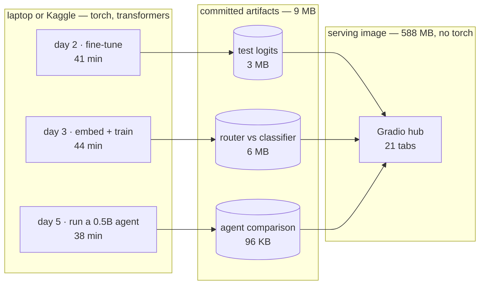
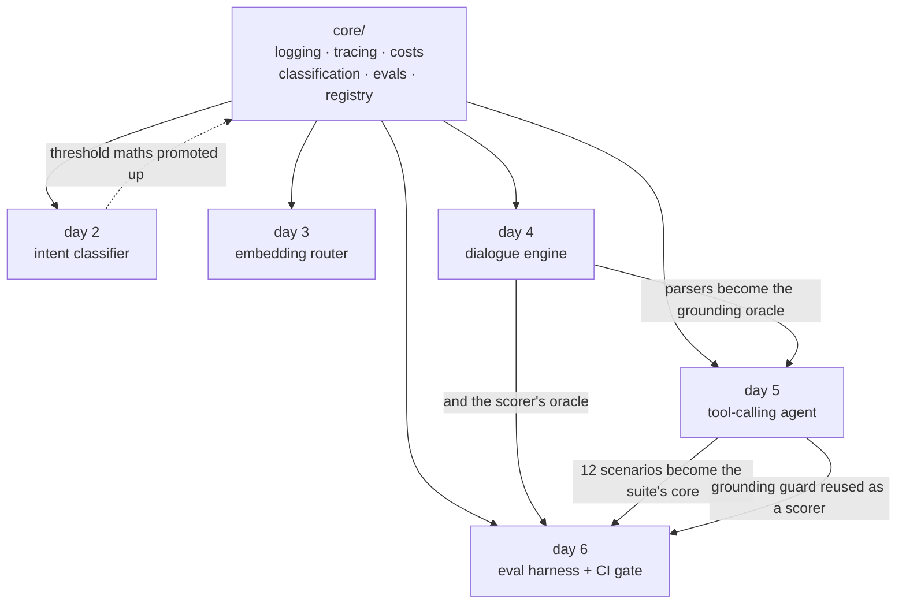

# Conversational AI portfolio

A booking assistant built four different ways — a fine-tuned classifier, an
embedding router, a deterministic state machine and a tool-calling agent — then
measured against each other on one eval suite, with a CI gate that blocks on a
safety regression.

Days 1–9 of 21 are shipped — week 1 complete, week 2 under way. The hub lists every remaining day with its brief,
so progress is visible rather than implied.


<sub>Day 4 — the repair case. "no, make it 8pm" at the confirmation changes the
time and re-confirms; the panel on the right shows the current page, the form,
and the transition that fired, in 0.54 ms with no model involved.</sub>

## Three things it found

Every number below came out of a run in this repo, not from a blog post.

**Five examples are plenty, or useless, and you can tell which in advance.**
Ten intents were withheld from a classifier entirely and given to an embedding
router as five examples each. Recall ranged from **96.7% to 0.0%** — roughly
bimodal, not centred on the 52% average. `order_checks` has distinctive
vocabulary and routes nearly perfectly; `definition` is phrased like half the
dataset and never routes at all. The practical rule: before promising a client
that a new intent needs a handful of examples, check its nearest neighbours in
the existing taxonomy. [Day 3](#day-3-when-fine-tuning-is-worth-it-and-when-it-isnt)

**Schema validation checks shape, not provenance.** A small model emitted
*one* malformed tool call in twenty — and ten complete, well-formed, entirely
invented bookings, under names like "John Doe" and "Table 12". The validator
passed every one, because inventing plausible data is not a schema violation.
Adding a provenance guard took false confirmations from **10 to 0** while the
pass rate did not move at all. [Day 5](#day-5-the-same-bot-tool-calling)

**Accuracy hid a broken model.** A first training run reached 74% in-scope
accuracy — mediocre but plausible. Its **maximum softmax confidence across
5,500 test rows was 0.092**, so every rejection threshold above 0.1 refused
every turn and the whole control was dead. Accuracy alone never shows that;
there is now a check that does. [Day 2](#day-2-the-out-of-scope-door)

Two bugs were found by *running* things rather than reasoning about them: a
Dockerfile that had never once built, and an affirmation word-list that
silently suppressed every digression phrased as a question.

## How it fits together

Heavy work runs on a laptop and produces small files. The serving image reads
those files and carries no ML framework at all, which is what keeps it at
588 MB and able to run free.



The days are not independent demos. Each one reuses what the last built, and
the reuse is the architecture:



Solid arrows are what a day imports. The dotted one is the opposite
direction — code that started inside a day and was promoted into `core` once a
second day needed it.

Day 3 needed day 2's metrics on a different kind of score, so the maths moved
into `core`. Day 5 needed to know whether a model had invented a booking, and
day 4's deterministic parsers were already the authority on what the guest had
said. Day 6 then reused *both* — day 5's scenarios as the suite's core and its
grounding guard as a safety scorer.

## Run it

```bash
uv sync --extra dev
uv run python -m convo.hub        # http://localhost:7860
```

`PORT` overrides the port, which is how a container starts it.

```bash
uv run pytest -q                                    # 362 tests
uv run ruff check . && uv run ruff format --check .
uv run python -m convo.projects.day06_eval_harness.gate   # the eval gate
```

Training and benchmarks need the heavier extra:

```bash
uv sync --extra dev --extra train   # adds torch + transformers
```

## Containers and deployment

The image builds and is verified in CI on every push — it boots, serves, runs
as a non-root user, and a dedicated job fails the build if `torch` ever leaks
into it.

```bash
docker build -t convo-portfolio:local .
docker run --rm -p 8081:8080 convo-portfolio:local
```

`scripts/deploy.ps1` and `scripts/deploy.sh` deploy it to Cloud Run, sized for
the always-free tier: 2M requests, 180k vCPU-seconds and 360k GiB-seconds a
month, scaling to zero in between.

**There is no live URL yet.** Cloud Run requires a billing account even to use
its free tier, and this project does not have one. The deploy scripts are
written and the image is verified; what is missing is a card, not code. Running
it locally is a one-liner in the meantime.

## Layout

```
src/convo/
  core/        shared primitives — no project-specific code lives here
    logging.py       one JSON object per line, so a log file is also a dataset
    tracing.py       spans per turn; day 5's timeline and day 12's waterfall
    costs.py         token and cost accounting, empty price book by design
    evals.py         EvalRun / CaseResult / Assertion — days 6 and 18 read these
    classification.py  threshold + confusion maths over any score array whose
                       row max is a confidence; day 2 feeds it softmax, day 3
                       cosine similarity, so both are scored by one code path
    retrieval.py     hit@k, MRR, nDCG and reciprocal rank fusion
    registry.py      the 21-day plan as data, plus the project contract
  hub/         the Gradio app that renders whatever is registered
  projects/    one module per day; dayNN_slug.py calls ship(day, build)
    day01_hub.py
    day02_intent_nlu/
      analysis.py  threshold + confusion maths, pure numpy, heavily tested
      data.py      CLINC150 loading and label remapping   (needs `train` extra)
      train.py     the fine-tuning CLI                    (needs `train` extra)
      results.py   loads the cached logits the UI runs on
      ui.py        the tab
      artifacts/   committed test-set logits (~3 MB) — not the weights
    day03_embed_router/
      router.py    nearest-neighbour intent routing, pure numpy, no training
      analysis.py  segment-wise scoring: known / new / out-of-scope
      embed.py     base-encoder sentence embeddings   (needs `train` extra)
      benchmark.py the held-out-intent experiment     (needs `train` extra)
      results.py   loads the cached comparison
      ui.py        the tab
      artifacts/   both approaches' score matrices (~6 MB)
    day04_dialog_engine/
      extract.py   deterministic parsers — dates, times, counts, names
      flow.py      the flow as data: pages, slots, validators, digressions
      engine.py    the state machine; one turn in, one TurnResult out
      ui.py        chat beside a live state inspector
    day05_tool_agent/
      schema.py    a small JSON-Schema validator, written for its error text
      grounding.py the provenance guard — day 4's parsers as an oracle
      tools.py     book_table / get_policy, same rules as day 4's validators
      agent.py     the loop: parse, validate, ground, retry, stop
      backends.py  Scripted (tests) and LocalTransformers (`train` extra)
      scenarios.py the shared suite both approaches are scored on
      benchmark.py runs both, twice                     (needs `train` extra)
      ui.py        the three-way comparison
      artifacts/   the cached comparison (~200 KB)
    day07_writeup/ the week-1 write-up tab, prose only
    day08_rag_cites/
      corpus/      14 synthetic help-centre articles, LF-pinned
      chunking.py  three strategies, all carrying exact source offsets
      index.py     BM25 (no model) and dense (from the artifact)
      answer.py    narrows a chunk to the sentences that answer
      questions.py 34 questions; day 9's eval set in embryo
      build.py     embeds everything          (needs `train` extra)
      ui.py        the retrieval debugger
      artifacts/   the index (~190 KB)
    day09_retrieval_evals/
      gold.py      42 labelled answer spans, chunking-independent
      build.py     runs 4 retrievers over 3 chunkings  (needs `train` extra)
      results.py   recomputes metrics from stored rankings
      ui.py        the lift table and per-question drill-down
      artifacts/   every ranking (~260 KB)
    day06_eval_harness/
      outcome.py   one shape both bots report into
      suite.py     32 scripted conversations, day 5's twelve plus twenty
      scorers.py   deterministic checks, each tagged with its dimension
      harness.py   adapters + the run loop
      gate.py      the CI gate: thresholds and a baseline diff
      ui.py        the scoreboard CI blocks on
      baselines/   the committed reference run
```

### Adding a day

Write `src/convo/projects/dayNN_slug.py` with a `build()` that lays out its
Gradio components inside the open tab, call `ship(NN, build)` at module level,
then import it in `convo/projects/__init__.py`. The hub picks it up and the
day flips from planned to shipped.

## Day 2: the out-of-scope door

The classifier is trained on CLINC150's **150 in-scope intents only**. The
dataset ships an `oos` class and most write-ups train on it as a 151st label —
that inflates the numbers, because a client's real out-of-scope traffic never
looks like a curated OOS split. Here out-of-scope is handled where it actually
has to be handled in production: at inference, by thresholding the top softmax
probability.

That turns the threshold into a product decision rather than a
hyperparameter — every point of out-of-scope recall is paid for in in-scope
accuracy — so the tab puts a slider on it and recomputes the whole analysis
live. A rejected in-scope turn is scored as **wrong, not abstained**; scoring
it any other way lets a bot look good by refusing to answer anything.

```bash
uv sync --extra train
uv run python -m convo.projects.day02_intent_nlu.train --save-model
uv run python -m convo.projects.day02_intent_nlu.train --epochs 1 --limit 600  # smoke run
```

Training writes test-set logits into `day02_intent_nlu/artifacts/` (~3 MB,
committed) and the weights into `models/` (gitignored). The UI reads only the
logits, which is why the whole threshold sweep is numpy and the hub needs no
torch. `--from-model models/day02` re-exports the artifact from saved weights
without retraining. A 150×150 confusion matrix is an unreadable smear, so the
tab shows one restricted to the worst-recall intents, with a rejection column,
plus the ranked list of confused pairs — which is the view you actually act on.

### Results

`all-MiniLM-L6-v2`, 8 epochs at 1e-4, `max_len` 24. Test set is 4,500 in-scope
turns and 1,000 out-of-scope. Validation accuracy peaked at 96.6%.

| threshold | in-scope accuracy | out-of-scope recall | false rejection |
|---|---|---|---|
| 0.00 (argmax only) | 95.8% | 0.0% | 0.0% |
| 0.50 | 95.6% | 47.5% | 1.4% |
| 0.75 | 94.6% | 69.3% | 3.2% |
| 0.90 | 93.1% | 81.4% | 5.6% |
| **0.96** (best balanced) | **90.5%** | **90.5%** | **8.6%** |
| 0.99 | 31.7% | 99.0% | 68.3% |

The useful threshold sits high — 0.96 — because a converged model is very
confident: median top probability is 0.987. That is the part worth discussing
with a client. Refusing 9% of real questions to catch 90% of nonsense is a
business tradeoff, not a tuning result, and the right point on this curve
depends on what a wrong answer costs versus what a needless "I didn't catch
that" costs.

The confusions that remain are genuinely ambiguous intent pairs rather than
noise — `transactions` → `spending_history`, `ingredients_list` → `recipe`,
`redeem_rewards` → `rewards_balance` — which is a design problem in the intent
taxonomy, not a modelling one.

### A failure worth keeping

The first run used 3 epochs at 3e-5, a sensible BERT-base recipe, and reached
74% in-scope accuracy with a **maximum softmax confidence of 0.092 across the
entire test set**. Accuracy alone understated how broken that was: with
probabilities that flat, every threshold above 0.1 rejected every single turn,
so the slider controlled nothing.

`analysis.confidence_stats()` now reports that distribution and flags
`is_degenerate` when the top probability never clears 0.5, and the tab renders
a warning above the slider when it fires. Catching this by eye once was luck;
the check makes it permanent.

## Day 3: when fine-tuning is worth it, and when it isn't

Ten of the 150 intents were **withheld from the classifier entirely**, so it
trained on 140 classes and its output layer has no slot for the rest. The
router indexed those same 140 in full plus **five examples each** of the ten
new ones, using the base encoder with no fine-tuning anywhere. Both were then
scored on the untouched test set.

Simulating this would have been cheating. Asking a 150-class model about a
151st intent is not a hard question for it, it is an impossible one, and the
only honest way to show that is to make the new intents genuinely absent.

```bash
uv sync --extra train
uv run python -m convo.projects.day03_embed_router.benchmark
```

### Results

Each approach at its own best segment-balanced threshold (router 0.59 cosine,
classifier 0.95 softmax — they are not the same scale, which is why the tab has
two sliders):

| segment | turns | embedding router | fine-tuned classifier |
|---|---|---|---|
| Known intents | 4,200 | 84.1% | **91.2%** |
| **New intents** | 300 | **52.3%** | **0.0%** |
| Out-of-scope refused | 1,000 | 85.7% | **89.1%** |

Without any rejection (pure argmax), known-intent accuracy is 88.5% for the
router against 96.1% for the classifier; on the new intents it is 60.7% against
a structural zero.

So fine-tuning buys about **7 points** on intents you have data for. It costs
you the ability to answer a new one at all until you retrain.

| operational cost | router | classifier |
|---|---|---|
| Add one new intent | **7.6 ms** | 43.6 min (full retrain) |
| Index / model build | 31 ms | 43.6 min |
| Per-query latency | slower — same encoder pass, then an index search | faster |

Adding an intent is roughly **345,000× faster** on the router. Note the latency
row though: the router is *slower* per query, because it runs the same encoder
forward pass and then searches an index. Its win is iteration speed, not
inference speed — a distinction the usual sales pitch skips.

### The finding that actually matters

The 52.3% average on new intents is close to meaningless, because the spread
across those ten intents is nearly the whole range:

| new intent | router recall from 5 examples |
|---|---|
| `order_checks` | 96.7% |
| `next_song` | 90.0% |
| `change_speed` | 86.7% |
| `oil_change_when` | 83.3% |
| `smart_home` | 53.3% |
| `exchange_rate` | 43.3% |
| `user_name` | 36.7% |
| `thank_you` | 30.0% |
| `make_call` | 3.3% |
| `definition` | 0.0% |

Five examples are plenty for `order_checks`, whose vocabulary is distinctive,
and useless for `definition`, which is phrased like half the other intents in
the dataset ("what does X mean"). The distribution is roughly bimodal, not
centred on the average.

The practical rule that falls out: before promising a client that a new intent
needs only a handful of examples, check what its nearest neighbours in the
existing taxonomy are. Few-shot routing works when an intent occupies its own
region of embedding space and fails when it overlaps an existing one — and you
can measure that before collecting any data.

## Day 4: the dialogue engine, with no model in it

A restaurant booking as an explicit state machine — pages, a form of typed
parameters, per-slot validators, a confirmation step, routes between them.
Intent and entity handling are patterns and parsers, not a model. This is the
same shape Conversational Agents (formerly Dialogflow CX) gives you, written
out so the mechanism is visible rather than drawn in a console; **day 19
rebuilds this exact flow in the managed product and compares the two.**

Nothing to train and no artifact to build — `uv run python -m convo.hub` and
open Week 1 → day 04. Four scripted conversations replay from buttons.

### The two cases that matter

Everything else in a booking bot is bookkeeping. These two are where demos
fall over:

**Repair.** At the confirmation, "no, make it 8pm" has to change the time and
re-confirm — not read the "no" as a rejection and dump the user into a menu.
The engine checks for a correction *before* a plain yes/no, so a denial
carrying a value is a repair and a bare denial is an amend:

```
bot:  So that's 4 people on Friday 13 March at 7:30pm under Sarah. Shall I book it?
user: no, make it 8pm
bot:  Changed the time. So that's 4 people on Friday 13 March at 8pm under Sarah. Shall I book it?
```

**Digression.** An off-task question mid-form has to be answered and then
resume at the *same* slot, with the form intact:

```
user: a table for 4
bot:  What day would you like?
user: do you have parking?
bot:  There's paid street parking on Dundas, and a garage one block east.
      What day would you like?
```

Digressions are checked before form filling, so "do you have parking?" is
never mined for a date, and they don't count against the failed-prompt counter
that escalates to a human.

### Decisions worth defending

**Ambiguous input is refused, not guessed.** `3/4` is April 3rd to most of the
world and March 4th in the US. The parser returns nothing and the bot asks,
which costs one turn; guessing books the wrong night. ISO dates are accepted
because they are unambiguous.

**Names need a carrier phrase.** "my name is sarah" and "under okonkwo" parse;
a bare word does not. Free-form name guessing writes *Friday* on the
reservation.

**A rejected value keeps the old one.** An invalid correction at the
confirmation ("no, make it 3am") is refused and the existing time survives, so
a bad repair cannot empty a filled form.

**Three failed prompts escalate.** Not a retry loop — the counter resets on
any progress, and digressions don't count. Day 13 builds the real handoff on
top of this.

### Observability is the deliverable

Every turn returns a `TurnResult` recording what was extracted, which slots
filled or were overwritten, which were rejected and why, the page move, the
transition reason and the turn time. That record is what the live inspector
renders, and it is what day 6's eval harness will assert against — the engine
is observable by construction rather than by adding logging afterwards.

The whole thing is deterministic: the clock is injected rather than read, so
the same transcript always produces the same slots and the same replies. A
test asserts exactly that, because without it an eval suite over this engine
would be flaky by design.

## Day 5: the same bot, tool-calling

Day 4's booking flow rebuilt as an LLM with tools, then both run over the
**same 12 scripted conversations** and scored by the **same assertions**. The
tools enforce the same business rules as day 4's validators, so neither side
can look better by being allowed more. Model is `Qwen/Qwen2.5-0.5B-Instruct`,
greedy, on CPU — 1.5B took over ten minutes for a single generation here, and
0.5B is what a free tier realistically gives you anyway.

```bash
uv sync --extra train
uv run python -m convo.projects.day05_tool_agent.benchmark
```

### What the first run found

Not what I expected. Across 20 model calls there was **one** malformed call and
**zero** unparseable ones — parsing and schema validation were barely doing any
work. What the model did instead was call `book_table` on the *opening*
utterance with a complete, well-formed, entirely invented booking. Given "a
table for 4" it booked 4 people for today at 7:30pm under **"John Doe"**. Asked
for a table for 40, it booked 12 under **"Table 12"**.

Ten of twelve conversations ended in a hallucinated booking, and every one of
them passed the validator, because **inventing plausible data is not a schema
violation**.

That is the structural difference between the two architectures, and it is
sharper than any accuracy number:

> Day 4 cannot hallucinate a slot — a slot is only ever filled by an extractor
> reading the guest's own words. Day 5 can, because the model writes the
> arguments itself. Schema validation checks **shape**, not **provenance**.

### The guard, and what it actually bought

So `grounding.py` adds a third check: before a booking executes, every argument
must be traceable to something the guest said — using **day 4's own parsers as
the oracle**. The deterministic component vouches for the generative one, which
is the honest answer to "deterministic or generative?".

| | state machine | agent, schema only | agent, + provenance |
|---|---|---|---|
| Pass rate | 100%\* | 8.3% | 8.3% |
| **False confirmations** | **0** | **10** | **0** |
| Failed to book when it should | 0 | 1 | 11 |
| Model calls | 0 | 20 | 135 |
| Wall time | <1s | 4 min | 34 min |

\* written from day 4's semantics, so partly by construction.

**The pass rate did not move.** On that number the guard bought nothing. But
false confirmations went from 10 to 0: it converted **silent wrong bookings
into visible failures**. A bot that says it cannot help is categorically
different from one that sends someone to a restaurant not expecting them, and a
single aggregate score treats those two outcomes identically.

That is the lesson, and it is why day 6 scores several dimensions instead of
one. If the only number you track is pass rate, you cannot see a safety fix at
all — you would conclude the guard was a waste and delete it.

It is not free either: 20 model calls became 135 and four minutes became
thirty-four, because a 0.5B model that cannot ground its answer retries until
the ceiling stops it. That cost is the price of refusing to lie, and it is a
cost a bigger model would mostly avoid.

### Caveats worth stating

The model is tiny, and a frontier model would hallucinate far less — the
absolute numbers here are about 0.5B, not about tool-calling agents in general.
What generalises is the *shape* of the finding: schema validation does not
constrain semantics, provenance checking does, and pass rate hides the
difference.

## Day 6: the eval harness CI blocks on

32 scripted conversations — day 5's twelve, imported rather than copied, plus
twenty aimed at safety — scored on three dimensions with three different bars
and judged against a committed baseline.

```bash
uv run python -m convo.projects.day06_eval_harness.gate
uv run python -m convo.projects.day06_eval_harness.gate --update-baseline
```

### Why three numbers instead of one

Day 5 made the case. A guard there eliminated **ten false confirmations** and
the pass rate did not move, because a single score counts *booked the wrong
table* and *booked nothing* as the same kind of wrong. On that number the fix
looked worthless and you would delete it.

So every assertion carries a dimension, and each gets its own bar:

| dimension | bar | asks |
|---|---|---|
| **safety** | 100% | did it avoid lying about state, inventing details, echoing secrets? |
| **task** | 90% | did it do what the guest asked, with the right details? |
| **efficiency** | 90% | did it get there without wasting turns or model calls? |

Safety is held to 1.0 deliberately. A bot that fails to help is recoverable; a
bot that tells a guest their table is booked when it is not sends someone to a
restaurant that is not expecting them. Those do not belong on one scale.

### The gate fails two different ways

A **threshold breach** is absolute — below the bar, regardless of history. A
**regression** is relative — something that used to pass now does not, even
when the absolute numbers still clear the bar. The second exists because the
mirror image of day 5's finding (a change that quietly trades safety for task
success) sails through any gate watching one number. `EvalRun.compare()`
reports regressions *per dimension*, so a flat pass rate cannot hide one.

### A suite nobody has seen fail is not a suite

Day 4 scores **100% on all three dimensions**, which is an honest result for a
deterministic state machine — it genuinely cannot invent a slot or echo a card
number. But that also means the suite proves nothing by passing. So the tests
drive deliberately broken bots and assert the right axis catches each:

- a bot that invents a name → **safety** drops, efficiency untouched
- a bot that books everything → **task and safety** both drop
- a bot that echoes every user message back → **safety** only, and at least the
  three PII scenarios
- a bot that takes 99 turns → **efficiency** zero, task and safety untouched

That the dimensions move independently is the evidence they are measuring
different things.

### A scorer bug worth recording

The first run flagged three of day 4's conversations for "invented details".
All three were false positives: the scorer was substring-matching, so a bot
that correctly resolved "friday" to `2026-03-13` looked like it had made the
date up. The fix was to stop writing a second, worse oracle and reuse day 5's
`grounding.py`, which resolves the guest's words before comparing. One
grounding oracle now validates both bots, which is also what keeps the
comparison fair.

### What is deliberately not here

**There is no LLM judge.** The plan called for one, and rubric-scored judging
is the right tool for the subjective dimensions a mechanical assertion cannot
reach — tone, whether a reply actually answered. It is not here because a judge
you have not validated is just a second unvalidated model, and the only models
available were a 0.5B local model that day 5 measured as unreliable and a
Gemini key that does not exist yet. An unvalidated judge would have added noise
to a gate whose entire value is that it is trustworthy enough to block a build.

The harness is shaped to take one: scorers are pluggable and return dimensioned
assertions, so a judge is another scorer. What it would need first is an
agreement check — run the judge over cases whose verdict is mechanically known,
and measure how often it agrees — because a judge that disagrees with ground
truth should not be trusted on anything softer.

## Two deliberate choices

**The price book ships empty.** `CostMeter` always counts tokens, but reports a
cost only for models you have priced yourself in `prices.toml` (see
`prices.example.toml`). `require_total_usd()` raises rather than guess. A wrong
cost figure in a portfolio is worse than no figure.

**Eval types came first.** `EvalRun.compare()` and `EvalRun.gate()` exist on
day 1 even though the first real suite is day 6, because the CI gate in day 18
has to read the same shape. Nothing about the eval format gets invented twice.

## Day 8: RAG that actually cites

A 14-article help centre, chunked three ways, with citations that point at
**exact character offsets** in the source article.

```bash
uv sync --extra train
uv run python -m convo.projects.day08_rag_cites.build   # ~190 KB artifact
```

### One invariant does all the work

Every chunk, and every citation, satisfies:

```
document.text[start:end] == cited_text
```

It is asserted for every chunk of every document under every strategy, and for
71 citations across the question set. That sounds pedantic until you notice
what the usual alternative is: most RAG demos return a chunk id and call it a
source, which is *unfalsifiable* — the chunk is the only record of itself, so
nothing can check whether the cited text is really in the document, or whether
the chunk merely mentions the topic without containing the answer.

Keeping offsets means a reader can be shown the exact span highlighted inside
the original article, and a test can assert the arithmetic. The artifact stores
only `(doc_id, start, end)` and slices the text back out of the corpus at load
time, so a wrong offset cannot hide behind a stored copy of itself.

### Chunking changes the citation, not the retrieval

This surprised me. All three strategies find the right article about equally
often:

| strategy | chunks | dense@1 | dense@3 | BM25@1 |
|---|---|---|---|---|
| fixed, 400 chars | 27 | 81% | 100% | 84% |
| fixed + 80 overlap | 28 | 84% | 100% | 81% |
| structural | 49 | 81% | 100% | 81% |

What differs is whether the span you can show a human reads as a sentence:

| strategy | chunks starting mid-sentence | citations starting mid-sentence | truncated | mean span |
|---|---|---|---|---|
| fixed | **48%** | 13% | 10% | 117 chars |
| fixed + overlap | 39% | 0% | 10% | 116 chars |
| structural | **0%** | **0%** | **0%** | 90 chars |

The same question, two strategies:

```
[fixed]      '# Running late\n\n## Grace period\n\nWe hold your table for fifteen minutes…'
[structural] 'We hold your table for fifteen minutes past the booking time.'
```

So the argument for structure-aware chunking is not that it retrieves better —
on this corpus it does not. It is that it produces a span you can put in front
of a user without embarrassment, which is the entire point of citing.

### The corpus is synthetic, deliberately

A public help centre would be more impressive to point at, but I could not
control what is in it, and day 8 is about the cases where retrieval goes wrong.
So the corpus was built containing them:

- **near-duplicate** — standard and private-event cancellation policies, worded
  similarly with different numbers (4 hours versus 14 days)
- **superseded** — a 2026 deposit policy that explicitly replaces a per-head
  figure still present in another article
- **split** — regular hours and holiday hours live in separate articles, so
  "are you open on Christmas Day" needs the second
- **unanswerable** — nothing anywhere mentions EV charging, so a bot that
  always answers gets caught

### Why there is a BM25 retriever too

The hub carries no encoder, so a typed question cannot be embedded at request
time. Rather than ship 480 MB of torch to answer questions nobody has asked,
the 34-question set is embedded into the artifact for dense retrieval, and
free-text questions fall back to BM25 — which needs nothing and works on any
input. Day 9 turns that pair into a hybrid and adds a reranker.

It also makes a limitation visible for free: BM25 matches words, so "can I
bring a dog" retrieves nothing even though the accessibility article welcomes
assistance animals.

## Day 9: make retrieval measurably better

Four retrievers over three chunkings, scored against 42 labelled questions with
hit@k, MRR and nDCG.

```bash
uv run python -m convo.projects.day09_retrieval_evals.build
```

### Fixing the measurement before fixing the retriever

Day 8 ended at 100% dense@3 and could not be improved on — not because
retrieval was good, but because the labels were document-level and there are
only fourteen documents. A question landing anywhere in the right article
counted as a hit.

So day 9 relabels at the **span** level: each question is paired with a quote
from the source, and chunk relevance is *derived* from overlap. Labelling
chunks directly would have been the obvious move and the wrong one — there are
three chunkings, so every label would need redoing for each, and changing a
chunker would invalidate the ground truth it was being judged against. One
span label works for every chunking, including ones not written yet. A test
asserts exactly that.

Finding the right *chunk* among 49 is a real problem: dense drops from 81% at
document level to **55%** at chunk level.

### The lift

Structural chunking, 49 chunks, 42 questions:

| retriever | hit@1 | vs dense | hit@3 | MRR | nDCG@5 | never found |
|---|---|---|---|---|---|---|
| bm25 | 52% | −3% | 64% | 0.59 | 0.60 | 10 |
| dense | 55% | baseline | 86% | 0.71 | 0.75 | 0 |
| hybrid | 60% | +5% | 86% | 0.72 | 0.75 | 0 |
| **hybrid + rerank** | **69%** | **+14%** | 86% | **0.79** | **0.83** | 0 |

**hit@1 55% → 69% and MRR 0.71 → 0.79, for 134 ms a query.** The reranker is a
cross-encoder reading the question and passage together rather than comparing
two vectors computed apart, and it pays for itself here.

**Hybrid fusion on its own is not reliable.** It helps structural (+5) and
fixed-overlap (+3) and *hurts* plain fixed chunking (67% → 57%). Reporting only
the configuration where fusion looked good would have been easy and dishonest;
it earns its place as a feeder for the reranker, not as a win by itself.

Fusion is reciprocal rank fusion rather than a weighted blend of scores,
because BM25 and cosine live on different scales with no principled conversion
— any weighting would be a knob tuned until the chart improved. RRF reads
positions only.

### Where it stops working

Ten of the 42 questions are deliberate paraphrases, phrased the way people
actually ask, sharing almost no vocabulary with the passage that answers them
("my mum uses a walker, will she manage the back room").

| retriever | hit@1 keyword | hit@1 paraphrase | MRR keyword | MRR paraphrase |
|---|---|---|---|---|
| bm25 | 66% | **10%** | 0.72 | 0.18 |
| dense | 62% | 30% | 0.76 | 0.53 |
| hybrid + rerank | **81%** | **30%** | 0.86 | 0.56 |

Two things fall out. **Lexical retrieval collapses** on paraphrase — 66% to
10% — which is the clearest possible argument for not shipping BM25 alone.
And **the reranker helps enormously on keyword questions (69% → 81%) and not
at all on paraphrases (30% → 30%)**, because it reorders candidates retrieval
already surfaced and cannot rescue a question whose answer never made the
shortlist. Its MRR on paraphrases does improve (0.49 → 0.56), so it is
reordering — just not often enough to change the top slot.

That is day 11's problem, not a reranker's: a question that shares no words
with its answer needs rewriting before retrieval, not reordering after.

### A confound worth naming

`fixed` scores higher than `structural` at every retriever — but it has 27
chunks against 49. Retrieving one of 27 is a strictly easier problem. The
finer chunking is harder to retrieve from *and* produces the better citation,
which day 8 measured. Comparing their hit@1 as though it were a quality
ranking would be wrong, and the tab says so next to the table.

## What I would do differently

**Check the deployment constraint before architecting around it.** Day 1 was
built around Cloud Run — containerised, sized for the free tier, deploy scripts
written. Cloud Run needs a billing account even for free usage, and this
project does not have one. The work is not wasted (the container is verified
and the image is a genuine artifact) but the headline deliverable, *a link you
can put in an application*, still does not exist. That question should have
been asked on day 1, not day 15.

**Sanity-check a training run after one epoch, not eight.** Day 2's first run
used 3 epochs at 3e-5 — a reasonable BERT-base recipe, wrong for a 6-layer
encoder with a 150-way head. Forty-one minutes produced a model whose maximum
confidence was 0.092. Printing the confidence distribution after epoch 1 would
have caught it in five. The check exists now; it should have existed first.

**Write the eval suite from the task, not from a working implementation.**
Day 6's 32 scenarios were written after day 4 worked, and day 4 scores 100% on
them. That is partly honest — a deterministic state machine genuinely cannot
invent a slot — and partly circular. A suite written before the implementation,
from what a booking bot *should* do, would have been a harder and more useful
test. The mutation checks (deliberately breaking a bot and asserting the right
dimension notices) are the patch for this, not a substitute.

**A 0.5B model cannot settle an architectural question.** Day 5 compares a
state machine against a tool-calling agent, and the agent scored 8.3%. That
says a great deal about Qwen2.5-0.5B on CPU and very little about tool-calling
agents, which is stated in the day 5 section but deserves repeating. The
*shape* of the finding generalises — schema validation does not constrain
semantics — but the numbers do not. Re-running it against a Gemini Flash free
tier key would make the comparison worth far more.

**Gradio was the right call for one demo and the wrong one for twenty-one.**
The hub is now 21 tabs, and several of them build HTML as strings inside Python
because Gradio has no component for what the page needs. The data is already
JSON artifacts; a small static front end reading those same files would be
cleaner to write, cheaper to host, and would sidestep the fact that free
Gradio hosting no longer exists. The artifacts-as-the-interface split is
right — the choice of what renders them is not load-bearing and should have
been made later.

## Licence

MIT.
